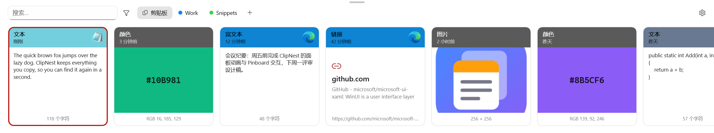
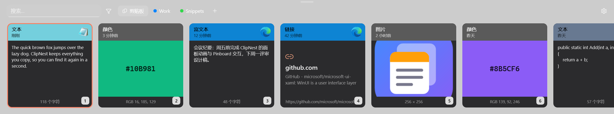
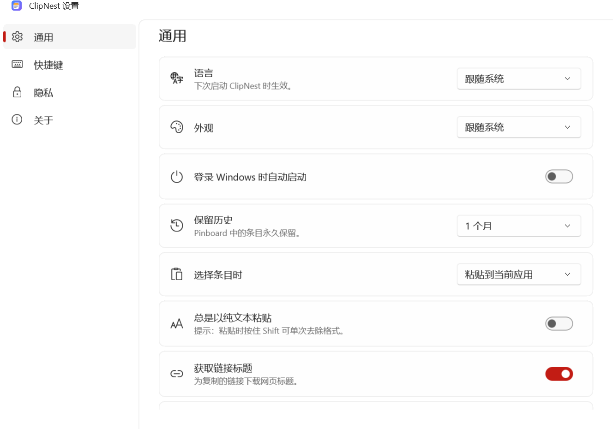

<p align="center"></p>

<h1 align="center">ClipNest</h1>

<p align="center">
  Windows 原生剪贴板管理器，交互与视觉参考 macOS 上的 <a href="https://pasteapp.io">Paste</a>。<br/>
  A native Windows clipboard manager inspired by <a href="https://pasteapp.io">Paste</a> for Mac.
</p>

<p align="center"><a href="#中文">中文</a> · <a href="#english">English</a></p>

<p align="center"></p>
<p align="center"></p>
<p align="center"></p>

---

## 中文

### 功能

- **完整剪贴板历史**：自动记录文本、富文本、图片、文件、链接和颜色。重复复制的内容不会生成新条目，而是移到最前。
- **底部卡片面板**：按 `Ctrl+Shift+V` 在当前屏幕底部滑出半透明面板。卡片头部的颜色取自来源应用的图标，并显示时间和应用图标。
- **即时搜索**：面板打开后直接输入即可搜索，中英文都支持子串匹配。还可以用筛选条件：`type:图片`、`app:chrome`、`date:7d`、`pin:工作`。
- **一键粘贴回原应用**：
  - `Enter` 或双击粘贴到原应用，`Shift+Enter` 以纯文本粘贴。
  - `Ctrl+1…9` 直接粘贴前 9 项。
  - 多选后可以一次粘贴多项。
- **Pinboards**：自建彩色收藏夹，固定进去的内容永不过期。`Ctrl+←/→` 切换。
- **Paste Stack**：按 `Ctrl+Shift+C` 打开，先连续复制多项，再连续按 `Ctrl+V` 按顺序逐条粘贴。
- **预览与编辑**：`空格` 快速预览，`Ctrl+E` 编辑文本，`Ctrl+R` 重命名，也可以把卡片拖到其他应用。
- **图片文字识别**：在本机用 Windows OCR 识别图片中的文字，识别结果可以被搜索。
- **隐私**：
  - 忽略密码管理器等标记为敏感的内容。
  - 可以排除指定应用、暂停记录。
  - 截图、录屏、屏幕共享时会隐藏 ClipNest 的窗口。
  - 所有数据只保存在本机。
- **轻量**：
  - 使用 Windows 自带的 SQLite（winsqlite3），没有原生依赖。
  - 面板隐藏一段时间后会自动释放内存。
  - 采用事件驱动，空闲时 CPU 占用为 0。

### 快捷键

| 操作 | 按键 |
|---|---|
| 打开 / 关闭面板 | `Ctrl+Shift+V`（可在设置中修改） |
| Paste Stack | `Ctrl+Shift+C` |
| 粘贴 / 纯文本粘贴 | `Enter` / `Shift+Enter` |
| 快速粘贴第 N 项 | `Ctrl+1…9`（加 `Shift` 为纯文本） |
| 切换条目 / Pinboard | `←` `→` / `Ctrl+←` `Ctrl+→` |
| 预览 / 编辑 / 重命名 / 固定 | `空格` / `Ctrl+E` / `Ctrl+R` / `Ctrl+P` |
| 仅复制 / 删除 / 撤销删除 | `Ctrl+C` / `Delete` / `Ctrl+Z` |
| 关闭 | `Esc` |

### 构建

需要 Windows 10 1809+，以及 [.NET 10 SDK](https://dotnet.microsoft.com/download)。

本地调试使用框架依赖模式，需要先安装 [Windows App Runtime 2.3](https://learn.microsoft.com/windows/apps/windows-app-sdk/downloads)：

```powershell
dotnet run --project tests/ClipNest.Core.Tests
dotnet run --project tests/ClipNest.Data.Tests
dotnet build src/ClipNest.App -c Debug -p:Platform=x64
```

发布版是自包含 + Native AOT，由 CI 构建，见 `.github/workflows/ci.yml`：

```powershell
dotnet publish src/ClipNest.App -c Release -r win-x64 -p:Platform=x64 -p:WindowsAppSDKSelfContained=true -p:SelfContained=true -p:PublishAot=true
```

数据保存在 `%LocalAppData%\ClipNest\`，包括数据库、图片和日志。

开发调试：
- `CLIPNEST_DATA=<目录>`：使用其他数据目录。
- `CLIPNEST_SNAPSHOT=<目录>`：写入示例数据，把面板和设置窗口渲染成 PNG 后退出。
- `ClipNest.exe --toggle`：切换面板显示（程序已在运行时）。

开发进度和待实测项见 [docs/STATUS.md](docs/STATUS.md)。

---

## English

### Features

- **Full clipboard history** — text, rich text, images, files, links and colors. Copying the same thing again moves it to the front instead of duplicating it.
- **Bottom card panel** — `Ctrl+Shift+V` slides a translucent panel up from the bottom of the current screen. Each card's header is tinted with its source app's color.
- **Instant search** — just start typing. Substring matching works for CJK text too. Filters: `type:image`, `app:chrome`, `date:7d`, `pin:work`.
- **Paste straight back**:
  - `Enter` or double-click pastes into the app you were using; `Shift+Enter` pastes plain text.
  - `Ctrl+1…9` pastes one of the first nine items.
  - Select several items to paste them all at once.
- **Pinboards** — colored collections that never expire. Switch with `Ctrl+←/→`.
- **Paste Stack** — `Ctrl+Shift+C`. Copy several things, then press `Ctrl+V` repeatedly to paste them in order.
- **Preview & edit** — `Space` previews, `Ctrl+E` edits, `Ctrl+R` renames. You can also drag cards into other apps.
- **Text in images** — on-device Windows OCR makes screenshots searchable.
- **Privacy**:
  - Skips content that apps (such as password managers) mark as sensitive.
  - Per-app exclusions and a pause switch.
  - ClipNest windows are hidden from screenshots, recordings and screen sharing.
  - Data never leaves your PC.
- **Lightweight**:
  - Uses the SQLite that ships with Windows (no native dependencies).
  - Frees memory when the panel has been hidden for a while.
  - Fully event-driven, with zero idle CPU.

### Build

Requires Windows 10 1809+ and the .NET 10 SDK. Local debug builds are framework-dependent and need Windows App Runtime 2.3 installed. See the commands above. Release builds (self-contained, Native AOT) are produced by CI.
