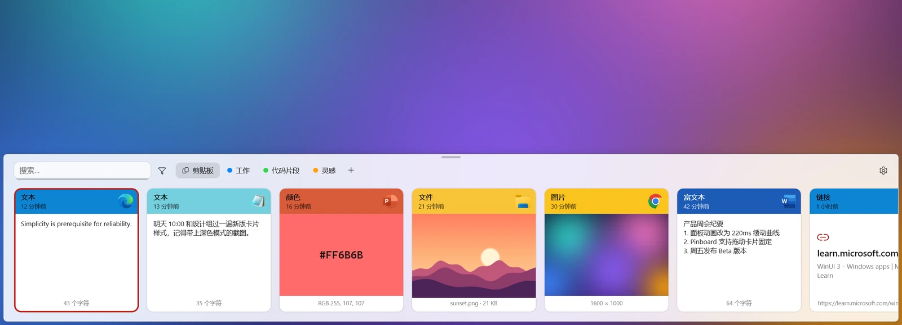
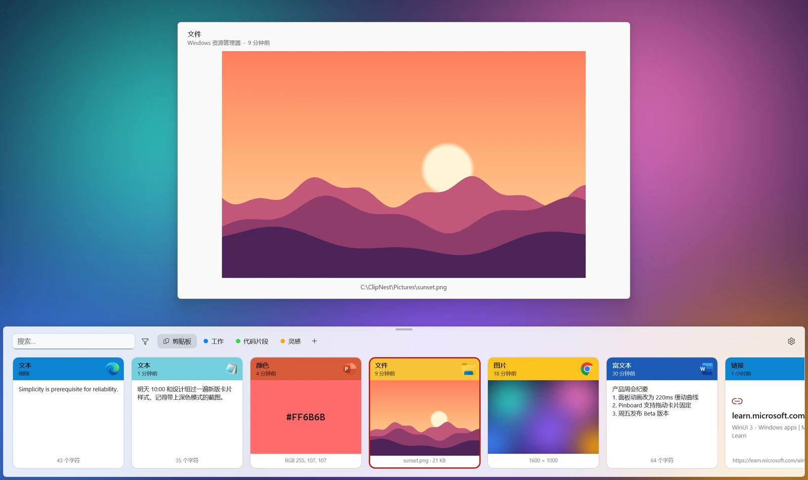
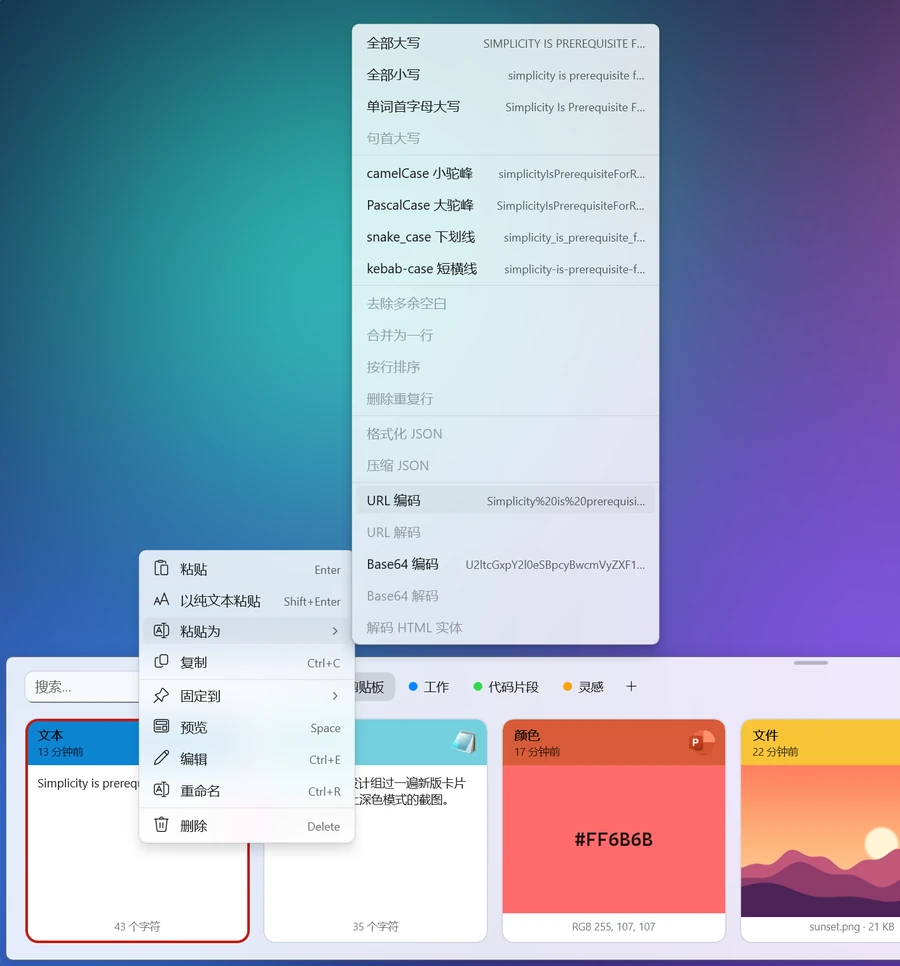
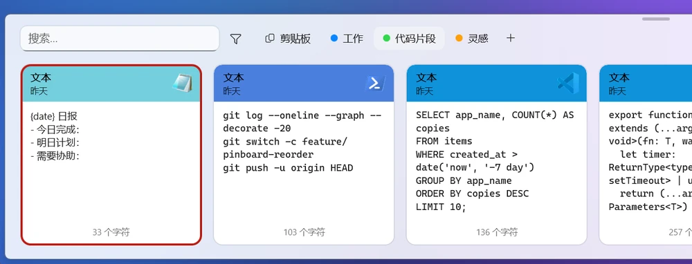
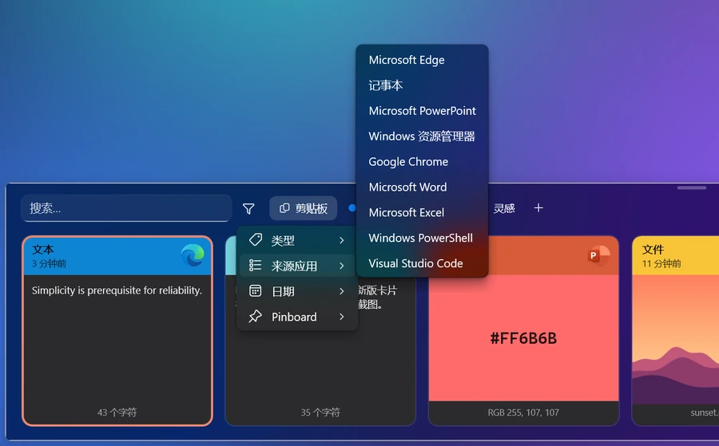
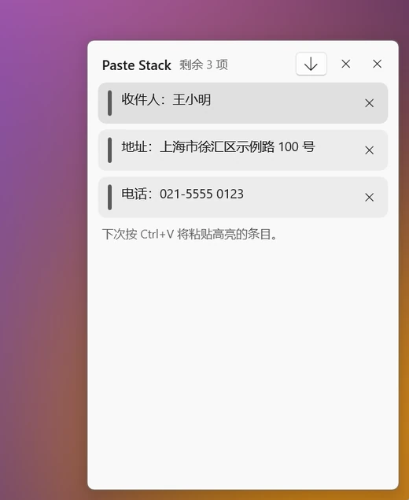
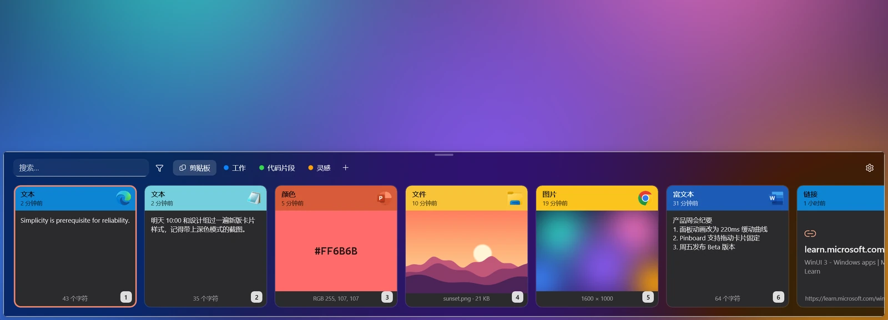
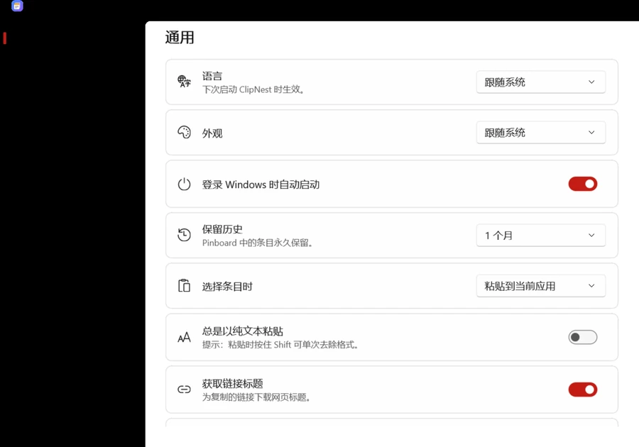
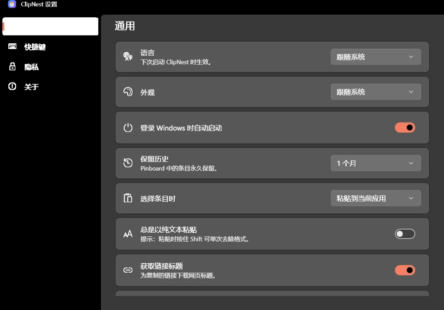

<p align="center"></p>

<h1 align="center">ClipNest</h1>

<p align="center">
  <b>把你复制过的一切，都收进一个漂亮的抽屉里。</b><br/>
  Windows 原生剪贴板管理器，交互与视觉参考 macOS 上的 <a href="https://pasteapp.io">Paste</a>。
</p>

<p align="center">
  <a href="../../releases/latest"></a>
  
  
  <a href="LICENSE"></a>
</p>

<p align="center"><a href="#中文">中文</a> · <a href="#english">English</a></p>

<p align="center"></p>

---

## 中文

按下 <kbd>Ctrl</kbd>+<kbd>Shift</kbd>+<kbd>V</kbd>，半透明的卡片面板从屏幕底部滑出。最近复制的文字、图片、文件、链接、颜色一字排开，用方向键选中，按 <kbd>Enter</kbd> 就粘贴回你刚才所在的应用。

不用安装运行时，解压即用。安装包约 28 MB，后台常驻只占约 20 MB 内存，空闲时 CPU 占用为 0。

### 一眼认出每一条

<p align="center"></p>

每种内容都有专门的卡片：

- **文字**：代码自动换成等宽字体。
- **颜色**：直接显示色块，并给出 RGB 值。
- **图片和图片文件**：显示缩略图。
- **其他文件**：显示真实的文件图标。
- **链接**：显示网页标题。

卡片顶部的颜色取自来源应用的图标，一眼就知道是从哪里复制的。按 <kbd>Space</kbd> 打开大图预览，不会打断你的操作。

### 粘贴为…

<table>
<tr>
<td width="52%"></td>
<td>

右键卡片，选择转换后的版本再粘贴。每一项都会**先预览结果**，不适用的选项自动置灰。

- **文本**：全部大写 / 小写、首字母大写、camelCase、snake_case、kebab-case
- **整理**：去多余空白、合并为一行、排序、去重
- **开发**：格式化或压缩 JSON、URL 和 Base64 的编码与解码
- **颜色**：HEX、RGB、HSL 互转
- **图片**：粘贴识别出的文字（本机 OCR）
- **文件**：粘贴文件路径

</td>
</tr>
</table>

### Pinboards：常用内容永久保存

<p align="center"></p>

自建彩色收藏夹，把卡片拖到标签上即可收藏，收藏的内容永不过期，<kbd>Ctrl</kbd>+<kbd>←</kbd> / <kbd>→</kbd> 切换。

点顶栏的 ✎ **新建文本**，可以把地址、签名、回复模板等常用文字直接写进 Pinboard（在剪贴板页新建会放进“常用”），以后打开面板一键填充。里面的文本还可以当作**片段模板**：粘贴时会自动展开 `{date}`、`{time}`、`{clipboard}` 等占位符。

经常用的某一条可以右键 **置顶**（<kbd>Ctrl</kbd>+<kbd>T</kbd>），它会一直排在最前面，也不会被自动清理。

### 搜得到，筛得准

<p align="center"></p>

面板打开后直接打字就开始搜索，中文、英文都支持子串匹配，图片里的文字也能搜到。还可以按类型、来源应用、日期、Pinboard 筛选，或者直接在搜索框里输入 `type:图片`、`app:chrome`、`date:7d`。

### Paste Stack：连续复制，按顺序粘贴

<table>
<tr>
<td>

填表、搬运资料时最好用：按 <kbd>Ctrl</kbd>+<kbd>Shift</kbd>+<kbd>C</kbd> 打开 Paste Stack，先依次复制好几项，再到目标位置连按 <kbd>Ctrl</kbd>+<kbd>V</kbd>，每按一次就粘出下一项。

顺序可以切换，单项可以移除，全部粘完后自动清空。

</td>
<td width="42%"></td>
</tr>
</table>

### 键盘党友好，深色模式

<p align="center"></p>

按住 <kbd>Ctrl</kbd> 会显示数字角标，<kbd>Ctrl</kbd>+<kbd>1</kbd>…<kbd>9</kbd> 直接粘贴对应的那一项。外观可以选浅色、深色或跟随系统，切换时立即生效。

- 可以在设置里开启 **<kbd>Win</kbd>+<kbd>V</kbd> 打开 ClipNest**，代替系统自带的剪贴板历史；关闭后 <kbd>Win</kbd>+<kbd>V</kbd> 恢复原样。
- 面板可以停靠在屏幕**底部、顶部、左侧或右侧**，从对应的边缘滑出；左右两侧时卡片竖向排列。
- 界面**字体**可以换成任意已安装的字体。

### 隐私优先

- 所有数据**只保存在本机**，没有账号，也不上传任何内容。只有在“关于”里点击**检查更新**时才会访问 GitHub。
- 自动跳过密码管理器标记为敏感的内容；私钥、API 令牌、JWT 等疑似密钥按内容识别，不会被记录。
- 可以排除指定应用、暂停记录、“忽略下一次复制”，也可以设置不记录图片。
- 截图、录屏、屏幕共享时自动隐藏 ClipNest 的窗口。

### 设置

<table>
<tr>
<td></td>
<td></td>
</tr>
</table>

中英双语界面，可设置快捷键、保留时长、开机启动，还能一键导出备份为 .zip 并从备份恢复。

### 快捷键

| 操作 | 按键 |
|---|---|
| 打开 / 关闭面板 | <kbd>Ctrl</kbd>+<kbd>Shift</kbd>+<kbd>V</kbd>（可在设置中修改），或开启后的 <kbd>Win</kbd>+<kbd>V</kbd> |
| Paste Stack | <kbd>Ctrl</kbd>+<kbd>Shift</kbd>+<kbd>C</kbd> |
| 粘贴 / 以纯文本粘贴 | <kbd>Enter</kbd> / <kbd>Shift</kbd>+<kbd>Enter</kbd> |
| 快速粘贴第 N 项 | <kbd>Ctrl</kbd>+<kbd>1</kbd>…<kbd>9</kbd>（加 <kbd>Shift</kbd> 为纯文本） |
| 切换条目 / Pinboard | <kbd>←</kbd> <kbd>→</kbd> / <kbd>Ctrl</kbd>+<kbd>←</kbd> <kbd>→</kbd> |
| 预览 / 编辑 / 重命名 / 固定 | <kbd>Space</kbd> / <kbd>Ctrl</kbd>+<kbd>E</kbd> / <kbd>Ctrl</kbd>+<kbd>R</kbd> / <kbd>Ctrl</kbd>+<kbd>P</kbd> |
| 置顶 / 取消置顶 | <kbd>Ctrl</kbd>+<kbd>T</kbd> |
| 仅复制 / 删除（需确认，再按一次 <kbd>Delete</kbd>）/ 撤销删除 | <kbd>Ctrl</kbd>+<kbd>C</kbd> / <kbd>Delete</kbd> / <kbd>Ctrl</kbd>+<kbd>Z</kbd> |
| 关闭 | <kbd>Esc</kbd> |

### 下载安装

到 [Releases](../../releases/latest) 下载，三种格式任选（Intel / AMD 电脑选 `x64`，骁龙等 ARM 电脑选 `arm64`）：

| 文件 | 说明 |
|---|---|
| `ClipNest-Setup-win-x64.exe` | **推荐**。安装程序，无需管理员权限，自动创建开始菜单快捷方式，可在“设置 → 应用”中卸载 |
| `ClipNest-win-x64.msi` | MSI 安装包，适合批量部署 |
| `ClipNest-win-x64.zip` | 便携版，解压到任意文件夹后运行 `ClipNest.exe` |

安装后按 <kbd>Ctrl</kbd>+<kbd>Shift</kbd>+<kbd>V</kbd> 开始使用。需要 Windows 10 1809 或更高版本。发布包是自包含的 Native AOT 构建，不需要安装 .NET 或 Windows App Runtime。

> 遇到问题或有建议，欢迎在 [Issues](../../issues) 反馈。

### 从源码构建

需要 [.NET 10 SDK](https://dotnet.microsoft.com/download)。本地调试使用框架依赖模式，还需要安装 [Windows App Runtime 2.3](https://learn.microsoft.com/windows/apps/windows-app-sdk/downloads)。

```powershell
dotnet run --project tests/ClipNest.Core.Tests
dotnet run --project tests/ClipNest.Data.Tests
dotnet run --project tests/ClipNest.Platform.Tests
dotnet build src/ClipNest.App -c Release -p:Platform=x64
```

发布版（自包含 + Native AOT）由 CI 构建，见 [`.github/workflows/ci.yml`](.github/workflows/ci.yml)。

<details>
<summary>技术栈与开发调试</summary>

- **界面**：WinUI 3（Windows App SDK 2.3）、`x:Bind`、Native AOT。
- **存储**：Windows 自带的 SQLite（winsqlite3）+ FTS5 trigram 全文索引，没有任何原生依赖。
- **系统集成**：剪贴板监听、`SendInput` 粘贴、全局热键、托盘图标，全部直接调用 Win32 API。
- **图像与文字识别**：WIC 和 Windows.Media.Ocr，都在本机完成。

数据保存在 `%LocalAppData%\ClipNest\`。开发时可用的环境变量和参数：

- `CLIPNEST_DATA=<目录>`：使用其他数据目录。
- `CLIPNEST_SNAPSHOT=<目录>`：写入示例数据，把面板和设置窗口渲染成 PNG 后退出（CI 冒烟测试用）。
- `CLIPNEST_DEMO=1`：写入演示数据并铺上生成的壁纸，不记录真实剪贴板（README 截图用）。
- `ClipNest.exe --toggle`：切换面板显示，可以绑定到其他快捷工具。

</details>

### 致谢

交互和视觉设计参考了 [Paste](https://pasteapp.io)；功能设计参考了 [Ditto](https://github.com/sabrogden/Ditto)、[CopyQ](https://github.com/hluk/CopyQ)、[Maccy](https://github.com/p0deje/Maccy)、[EcoPaste](https://github.com/EcoPasteHub/EcoPaste)、[PasteBar](https://github.com/PasteBar/PasteBarApp) 和 [PowerToys](https://github.com/microsoft/PowerToys) 等优秀的开源项目。

### 许可证

[MIT](LICENSE)

---

## English

**Everything you copy, kept in one beautiful drawer.** ClipNest is a native Windows clipboard manager inspired by [Paste](https://pasteapp.io) for Mac.

Press <kbd>Ctrl</kbd>+<kbd>Shift</kbd>+<kbd>V</kbd> and a translucent card panel slides up from the bottom of the screen. Pick an item with the arrow keys and press <kbd>Enter</kbd> to paste it straight back into the app you were using.

No runtime to install, just unzip and run. The download is about 28 MB, it idles at around 20 MB of memory, and it uses zero CPU while idle.

### Highlights

- **A card for every kind of content** — text (code in a monospace font), rich text, images, files (with real previews and icons), links (with page titles) and colors (with swatches). Headers take the color of the source app. <kbd>Space</kbd> opens a large preview.
- **Paste as…** — right-click to paste a transformed version, with a live preview of each option: case changes, camelCase / snake_case / kebab-case, whitespace cleanup, sorting and de-duplicating lines, JSON pretty / minify, URL and Base64 encode / decode, HEX / RGB / HSL colors, OCR text from images, and file paths.
- **Pinboards** — colored collections that never expire. Drag a card onto a tab to pin it, or write your own text (addresses, signatures, reply templates) with **New text**. Pinned text works as a snippet template: `{date}`, `{time}` and `{clipboard}` expand when pasted.
- **Pin to top** — <kbd>Ctrl</kbd>+<kbd>T</kbd> keeps an item at the front of the list, and it is never cleaned up.
- **Search and filters** — just start typing. Substring matching works for CJK too, and text inside images is searchable. Filter by type, source app, date or Pinboard, or type `type:image`, `app:chrome`, `date:7d`.
- **Paste Stack** — <kbd>Ctrl</kbd>+<kbd>Shift</kbd>+<kbd>C</kbd>. Copy several things, then press <kbd>Ctrl</kbd>+<kbd>V</kbd> repeatedly to paste them in order.
- **Keyboard first** — hold <kbd>Ctrl</kbd> to see number badges, then <kbd>Ctrl</kbd>+<kbd>1</kbd>…<kbd>9</kbd> pastes one directly. Optionally take over <kbd>Win</kbd>+<kbd>V</kbd> from the Windows clipboard history.
- **Your layout** — dock the panel to the bottom, top, left or right edge (it slides in from there), pick any installed font, and choose a light, dark or system theme.
- **Private by design**:
  - Data never leaves your PC, and there is no account. GitHub is contacted only when you click **Check for updates**.
  - Content marked sensitive (password managers) and anything that looks like a key or token is skipped.
  - You can exclude apps, pause recording, or ignore the next copy.
  - ClipNest's windows are hidden from screenshots and screen sharing.
- **Backup** — export everything to a .zip and restore from it.
- **Bilingual UI** — English and Simplified Chinese.

See the screenshots above. The shortcut table in the Chinese section applies as-is.

### Install

Download from [Releases](../../releases/latest). Pick `x64` for Intel / AMD PCs or `arm64` for ARM PCs:

- `ClipNest-Setup-win-<arch>.exe` (recommended): a per-user installer that needs no admin rights and adds a Start menu shortcut.
- `ClipNest-win-<arch>.msi`: an MSI package for managed deployment.
- `ClipNest-win-<arch>.zip`: a portable build. Unzip it and run `ClipNest.exe`.

Requires Windows 10 1809 or later. Release builds are self-contained Native AOT, so no .NET or Windows App Runtime install is needed.

### Build

Requires the .NET 10 SDK. Local debug builds are framework-dependent and also need Windows App Runtime 2.3. See the commands in the Chinese section. Release builds are produced by CI.

### License

[MIT](LICENSE)
